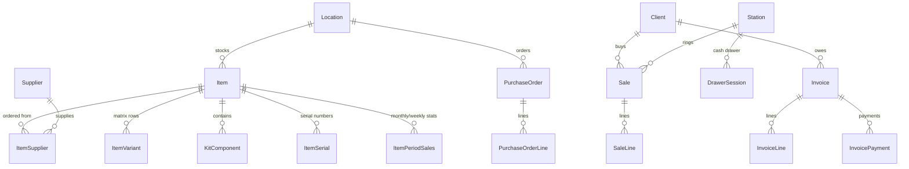

# Data layer plan: SQL Server with a one-time DBF import

Draft 1, 2026-10-24. Decision taken: each store moves to the new app in one step at cutover. Its Retail Plus data is imported once, and the two programs never write the same data. This replaces the "live DBF compatibility" approach in the rewrite plan. Background: [the Phase 0 spike](spikes/phase0-rdd-spike.md) showed that no available DBF engine is safe with several writers.

[DATA_FORMATS.md](DATA_FORMATS.md) stays the reference for the source files. It is now an import contract: we only have to **read** those files correctly, never write them back. The one exception is the store-to-store exchange files (section 8).

## 1. Engine: SQL Server Express

**Recommendation: SQL Server Express (2022 or 2025) as the store database, on the PC that hosts the data today.** Every workstation connects to it over the LAN. A single-PC store runs the same setup on its one machine, so there's one code path and one test matrix.

| | SQL Server Express | SQLite |
|---|---|---|
| Several workstations on a LAN (common for Retail Plus: station IDs 001–999, the manual's network appendix) | Built for it: client/server over TCP | Not safe as a file on a network share. SQLite's own guidance: "if your data is separated from the application by a network, you want to use a client/server database". Supporting LAN stores would mean writing and running our own server process on the host |
| Money and quantities | Exact `decimal` columns | No decimal type; EF Core stores decimals as text, which limits sorting and sums in SQL |
| Size and capacity | 2022: 10 GB per database; 2025: 50 GB. Buffer pool about 1.4 GB, lesser of 1 socket or 4 cores | Unlimited in practice |
| What it costs us | An installer step, a Windows service, our own backup scheduling (Express has no SQL Agent) | Nothing to install |

Rough size: 20,000 items and 300 sales lines a day come to about 100 MB a year including indexes, so even the 10 GB limit lasts decades. Photos stay as files rather than in the database.

SQLite remains a possible later "single-PC lite" edition. The data access layer won't use SQL Server-only features without a reason, but supporting two engines isn't part of this plan. (PostgreSQL would also work; it wasn't on your shortlist, and SQL Server's Windows installer and tools fit small Windows shops better.)

For development and tests this PC already has SQL Server 2022 Express (`.\SQLEXPRESS`) and LocalDB. Tests run against LocalDB. CI uses LocalDB where the runner has it, otherwise a SQL Server container.

## 2. Topology and deployment

```
Host PC (today: the PC sharing the Retail Plus folder)
  SQL Server Express instance RETAILPLUS, TCP on a fixed port, firewall rule for the LAN
  Database RetailPlus_<store>          one per store install; all locations inside it
  C:\RetailPlus\Photos                 imported PICS folder, shared read-only to workstations
  C:\RetailPlus\Backup                 database backups (section 6)
Workstations (and the host itself)
  RetailPlus.App
  %ProgramData%\RetailPlus\station.json  connection string (password protected with DPAPI), station ID, local devices
```

- **Authentication:** SQL login per store, created by the installer. Windows authentication is awkward in the workgroup networks small shops use. Connections are encrypted; with no CA, the installer's self-signed certificate is trusted explicitly on each workstation.
- **Installer:** installs SQL Server Express silently (named instance, TCP enabled on a fixed port, browser service not needed), or points at an existing instance. It also creates the database, applies migrations, and runs the import (section 5).
- **Same failure mode as today:** if the host PC is down, the tills stop, exactly as with a shared Retail Plus folder. An offline till mode would be a new feature, not part of parity.

## 3. Data access in the app

- **EF Core 10 with the SQL Server provider**, code-first migrations checked into the repo. Browse grids, forms and module logic go through EF. Reports and bulk operations (batch price changes, year-end, PO generation) may use hand-written SQL where it is much simpler or faster.
- **Transactions where the original had none.** Saving a sale updates stock, the sales log, the drawer session, the client's history and points, and the invoice, all in one transaction. Stock changes are atomic (`UPDATE … SET OnHand = OnHand - @qty`), never read-modify-write.
- **Optimistic concurrency.** Master rows people edit (items, clients, suppliers, invoices, POs) carry a `rowversion`. If two users edit the same record, the second save is told the record changed and is shown the new values. That replaces the original's record locks.
- **Numbering:** invoice, customer, PO and RMA numbers come from SQL Server `SEQUENCE` objects. They start above both `NUMBERS.DBF` and the highest number found in the imported data. Users can still reset "next number" in Setup, as the manual describes; that maps to `ALTER SEQUENCE … RESTART`.
- **Flags stay shared**, as in the original: the flag column on browse grids is stored on the row (`IsFlagged`), so all workstations see the same flags. That's how the manual's "Unflag All before a new selection" advice works.
- **Soft delete** for items, clients and suppliers (`IsDeleted`, `DeletedAt`) keeps "Undelete Items" working. The Rebuild command becomes "purge deleted records + integrity check + index maintenance".
- **Settings:** store-wide settings (today's `SETUP.DBF`) live in a typed `StoreSettings` row. Per-workstation settings (today's `Plus50.INI`) live in the database keyed by station ID, so a replaced PC only needs its station ID. The only local file is `station.json`.

## 4. Schema

### Conventions

- Surrogate `int` primary keys; the original's natural keys (stock code, customer number, account number, invoice number) keep unique indexes.
- Text is `nvarchar`, at least as long as the source field. The app enforces the original lengths until a feature deliberately changes them.
- Amounts `decimal(12,2)`; unit costs `decimal(12,3)` (the source keeps 3 decimals); quantities `decimal(12,3)` (source has 2; weights may need 3); rates `decimal(7,3)`.
- Dates `date`, timestamps `datetime2(0)`; a blank DBF date becomes `NULL`.
- Database collation `Latin1_General_100_CI_AS`. Case-insensitive, matching the original's `UPPER()` indexes and its case-insensitive prefix searches.
- Indexes mirror the original's index tags, so every browse sort order in the manual stays fast (DATA_FORMATS section 3).

### Tables (grouped by module, with their source)



| Area | Tables | Source |
|---|---|---|
| Store and stations | `StoreSettings` (1 row), `Station`, `StationSetting` (section/key/value, mirrors the INI), `TaxConfiguration` (default + up to 12 out-of-state), `TenderType`, `FxRate`, `DocumentText` (invoice header/footer, PO header, return address) | `SETUP.DBF`, `Plus50.INI`, `HEADER.TXT`, `FOOTER.TXT`, `POHEADER.TXT`, `RETADDR.ADD`, plus files not captured yet (tender types, FX rates, out-of-state taxes) |
| Users and staff | `UserAccount` (username, password hash, level 0–4, must change password), `StaffPeriod` | `USERS.DBF`, `STAFF.DBF` |
| Inventory | `Location` (3-char code), `Department`, `Category`, `Item`, `ItemSupplier`, `ItemMatrixColumn` + `ItemVariant`, `KitComponent`, `ItemSerial`, `ItemPeriodSales` (year, month or week, units, gross), `FastKey` | `<LOC>INV.DBF/.FPT` per location folder, `DEPT.DBF`, `CATEGORY.DBF`, `FASTKEYS.DBF` |
| Clients and suppliers | `Client`, `Supplier` (same shape, separate tables), `ClientRecurringCharge` | `CLIENTS.DBF/.FPT`, `SUPPLIER.DBF/.FPT` (the recurring-billing fields sit inside `CLIENTS`) |
| Sales | `Sale` (header), `SaleLine`, `SalePayment`, `DrawerSession`, `DrawerSessionTender`, `SuspendedSale`, `CustomerOrder`, `Rma`, `GiftCertificate` | `SALESnnn.DBF` and `TOTALnnn.DBF` per station and location, `SUSPEND.DBF`, `BACKORD.DBF`, `RMA.DBF`, gift certificate file (not captured yet) |
| Accounts receivable | `Invoice` (invoice, quote or layaway by type), `InvoiceLine`, `InvoicePayment` | `INVOICES.DBF/.FPT` (lines inside the `NOTES` memo; format not captured yet) |
| Purchasing | `PurchaseOrder`, `PurchaseOrderLine` (+ per-variant quantities), `StockAdjustment`, `StockTransfer` | `<LOC>\PO\PO<n>.<LOC>`, `ADJUST.DBF`, `TRANS.DBF` (last two not captured yet) |
| Import trace | `ImportBatch`, `ImportSourceRow` (entity, new id, source file, record number, the full source record as JSON) | written by the importer |

Main transformations, from flat DBF to normal tables:

| Source | Becomes |
|---|---|
| `MATRIX` memo `Color,Size,Style,\|Blue,L,Regular,15.00\|…` | `ItemMatrixColumn` (up to 3 headings) + one `ItemVariant` per row with its on-hand; a `CODE` first column becomes `ItemVariant.Code`, indexed for scanning |
| `SUPLIST` memo `\|SUPPLIER,code,cost,qty\|…` | `ItemSupplier` rows in preference order, linked to `Supplier` by name |
| `KIT`, `SERNO` memos | `KitComponent`, `ItemSerial` rows |
| `JAN_GROSS`…`DEC_VOLUME`, `LASTYR` (12 values), `WEEKLY` (54 values) | `ItemPeriodSales` rows for this year and last year. Year-to-date totals are computed from them instead of being stored twice. Year-end no longer moves numbers between columns; it closes a year |
| `SUPPLIER`, `DEPT`, `CATEGORY` stored as names on items | Foreign keys to `Supplier`, `Department`, `Category`; unknown names create rows and are listed in the import report |
| `SALESnnn` line log (one file per station) | `SaleLine` rows tagged with station and location; `Sale` headers built by grouping on station + `INVNO`; card fields (`AUTHCODE`, `REFNO`, …) move to `SalePayment` |
| `TOTALnnn` fixed tender columns (`R_CASH`, `R_VISA`, …) | `DrawerSession` + one `DrawerSessionTender` row per tender type, so the configurable tender list from the manual fits |
| `CLIENTS.NOTES` purchase history (about 400 sales per client) | Kept as `Client.LegacyHistory` text; history after cutover comes from `Sale`/`SaleLine`, with no per-client limit |
| `PICPATH` absolute paths (`C:\Retail Plus 30\PICS\Polo.JPG`) | Files copied to `C:\RetailPlus\Photos`; path stored relative to it |

## 5. The importer

A library (`RetailPlus.Migration`) used by a command-line tool and by an "Import from Retail Plus 5.x" wizard in the installer. It reads, never writes, the source folder.

**DBF reader.** A small read-only C# reader for DBF + FPT, built from the rules in DATA_FORMATS: long character fields, two-digit header years, soft-deleted records, CP1252, stray NUL bytes, older table structures with missing fields. It needs no index files and has no X# dependency. The Python tools in `tools/dbf` act as its test oracle.

**Input.** A Backup set made with Retail Plus' own *Tools / Backup* command, or a copy of the live folder taken after every workstation has closed the program. The importer records the SHA-256 of every source file in the report, so the report proves which data was imported.

**Stages:**

1. **Discover.** Find the root tables, every location folder, every `SALESnnn`/`TOTALnnn` pair, the PO files, the photos and the text files. Detect structure variants and unknown fields.
2. **Parse** each table into staging records, keeping the raw record.
3. **Validate** with the rules below, producing errors (blocking) and warnings (reported).
4. **Transform** into the target model (section 4 mappings).
5. **Load** into an **empty** database in one transaction, using bulk insert. Re-running means recreating the database, so the import is repeatable.
6. **Verify** control totals between source and target. A mismatch fails the import.
7. **Report:** an HTML and JSON summary to sign off before the store opens.

**Data-quality rules:**

| Situation | Handling |
|---|---|
| Duplicate stock code within a location (the original allows these and has a "Duplicate Check" tool) | Blocking in the final run. The dry-run report lists them so they can be fixed in Retail Plus beforehand. Proposed: the new app enforces unique stock codes; see open question 2 |
| Duplicate customer or account numbers | Same as duplicate stock codes |
| Item references a supplier, department or category name that doesn't exist | Create the row and warn |
| Invoice references an unknown account number | Import, link by name if unambiguous, warn |
| Deleted records (`*`) | Skipped and counted |
| Blank or impossible dates; non-numeric text in numeric fields | `NULL` or 0, with a warning naming file, record and field |
| Packed memo that doesn't parse | Keep the raw text in `ImportSourceRow` and warn; the item still imports |
| Suspended sales present, or a drawer session not closed with End of Day | Blocking in the final run: the cutover runbook clears them first |
| Unknown extra fields | Kept in `ImportSourceRow` and listed in the report |
| Passwords in `USERS.DBF` | Usernames and access levels import. If the stored password turns out to be plain text, it's hashed on import; otherwise each user sets a new password at first login (open question 3) |

**Verification, source vs target:**

- Record counts per table (non-deleted).
- Inventory per location: item count, total on-hand, on-hand × average cost, this year's gross sales.
- Client and supplier counts.
- Accounts receivable: open invoices and sum of balances; layaways; gift certificates outstanding.
- Sales log: line count and total per station per month.
- Next numbers (invoice, customer, PO, RMA).
- 20 random items, clients and invoices printed side by side for a human check.

**Performance target:** 50,000 items and 1,000,000 sales lines in under 5 minutes on a store PC.

**Tests:** the sample data shipped with Retail Plus, generated edge cases (every rule above), and at least two anonymised real store backups before the first pilot.

## 6. Backup, restore and rebuild

SQL Server Express has no scheduler, so the app keeps the original's behaviour itself:

- *Tools / Backup*: full database backup to `C:\RetailPlus\Backup` on the host, then a copy to a folder the user picks (USB stick). The manual's rotating Mon–Fri folders still work.
- Automatic backup at End of Day on the host station. That replaces "backup on exit", which no longer fits a shared database.
- *Restore*: from a chosen backup file, after warning and disconnecting the other stations.
- *Rebuild*: purge soft-deleted rows, run `DBCC CHECKDB`, rebuild indexes.

## 7. Cutover runbook, per store

| When | Step |
|---|---|
| A week before | Dry-run import from a fresh Backup set. Fix the reported data problems in Retail Plus (duplicates, odd records). Train staff on a test database made from that import |
| Day before | Second dry run; the report must be clean |
| After closing | 1. End of Day on every station. 2. Recall or void suspended sales. 3. Note open POs. 4. Retail Plus *Tools / Backup* to a new folder. 5. Close Retail Plus everywhere. |
| | 6. Final import from that backup. 7. Check the verification report and the side-by-side spot checks. 8. Rename the old Retail Plus folder so nobody keeps using it by accident. 9. Start the new app on each station and ring a test sale, then void it |
| Go / no-go | Decided **before the first real sale**. Until then, rollback means renaming the folder back, since the old data is untouched. After the first sale, rolling back means re-keying those sales into the old program |

## 8. Where DBF files still matter after cutover

- **Mixed estates.** Stores exchange stock transfers, stock updates, sales history and stock levels as DBF + FPT files over FTP. If some stores stay on the old program for a while, the new app has to read and also **write** those files in the old format. They are standalone files written by one process, so a simple writer is enough and none of the multi-writer problems apply. Whether the old program expects an index file next to them still has to be checked. Estimate 1–2 weeks, only if needed (open question 1).
- **Year-end archives** from the old program can be imported later as last-year statistics. The new app writes archives as `.xlsx`/CSV.
- **"Open in MS-Excel"** becomes an `.xlsx` export.

## 9. Open questions

1. Will every store move at once, or will some stay on Retail Plus for a while? That decides whether the exchange-file writer is needed (section 8).
2. Enforce unique stock codes and customer numbers in the new app? Recommended: yes. The importer then blocks until duplicates are fixed.
3. Passwords: hash on import if they're stored in plain text, or require new passwords at first login? Needs one real `USERS.DBF` to decide; the values are never shown.
4. How much sales history to import: all of it (recommended; it's small) or the last N years?
5. Formats still to capture from real data before the importer can be finished: invoice and quote lines inside `INVOICES.NOTES`, `DOCTYPE` values, client purchase history, suspended sales, layaways, gift certificates, tender types, FX rates, out-of-state taxes, stock adjustments, transfers. An anonymised backup from a store that has used these features answers most of them at once.

## 10. Work breakdown (replaces Phase 1 of the rewrite plan)

| Step | Deliverable | Effort | Status (2026-10-24) |
|---|---|---|---|
| 1 | Projects: `RetailPlus.Data` (EF Core, SQL Server), `RetailPlus.Migration` (reader + importer + CLI); `RetailPlus.Data.Dbf` is retired | 1 day | Done, including the `RetailPlus.Import` CLI |
| 2 | Schema for all modules, first migration, LocalDB-backed integration test setup | 1.5 weeks | Done: `InitialCreate` plus `SalesReceivablesPurchasing` (sales, payments, drawer sessions, suspended sales, customer orders, RMAs, tender types, tax configurations, FX rates, fast keys, staff periods, stock adjustments, invoices, purchase orders); 25 integration tests pass |
| 3 | DBF/FPT reader with oracle tests against `tools/dbf` | 3 days | Done: 18 tests; matches the oracle on 6 synthetic fixtures and on 44 real tables (1,504 records) |
| 4 | Importer stages for the tables already known (inventory, clients, suppliers, sales log, drawer, back orders, RMA, POs, settings, users) + verification + report | 2 weeks | Done: one transaction, control totals, Markdown/JSON report; the sample data imports with all totals matching |
| 5 | Remaining formats once real data is available (open question 5) | 1 week | |
| 6 | Backup/restore/rebuild, sequences, settings API | 3 days | Done (`BackupService`, `SetupService`) |
| 7 | Installer pieces: SQL Server Express silent install, database creation, firewall, `station.json` | 1 week (can move to the deployment phase) | |

Schema notes from step 2: the recurring charge sits as columns on `Client` (one per client) instead of a separate table; `FastKey` waits until the key-numbering scheme in `FASTKEYS.DBF` is understood; SETUP fields whose meaning the manual doesn't make clear are kept as `StoreSettingExtra` rows under their original names.

About 7 weeks in total (6 if the installer work moves to the deployment phase), against 4 weeks for the old data-layer phase. The lock/CDX risk is gone, and the importer also becomes the bridge for parity testing: a scenario run in the old program is imported and compared table by table with the same scenario run in the new app.
